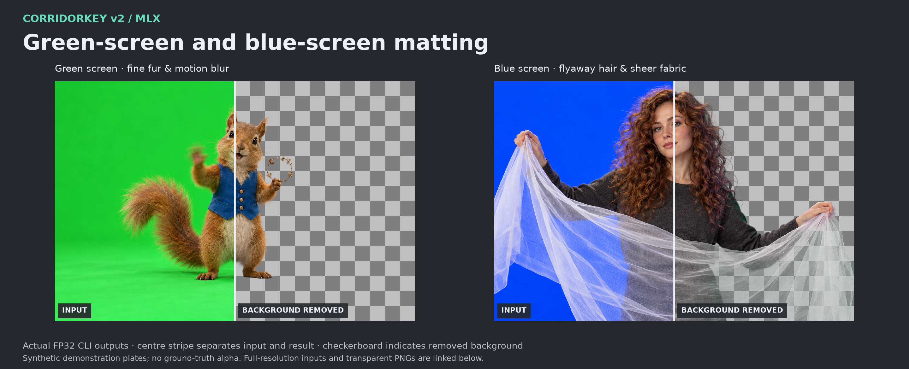
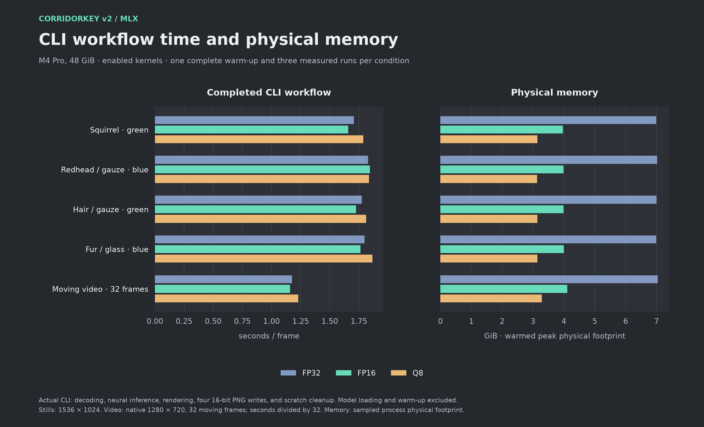
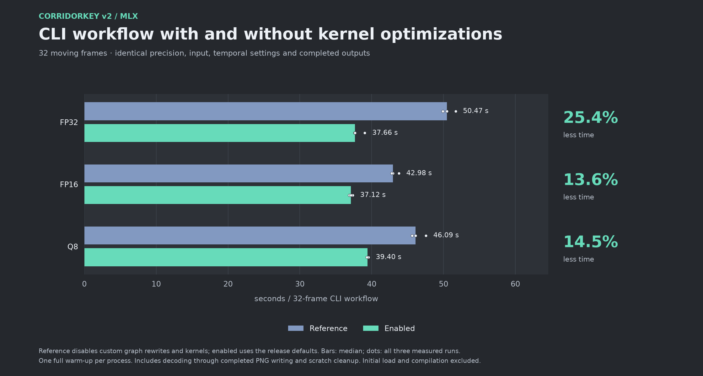
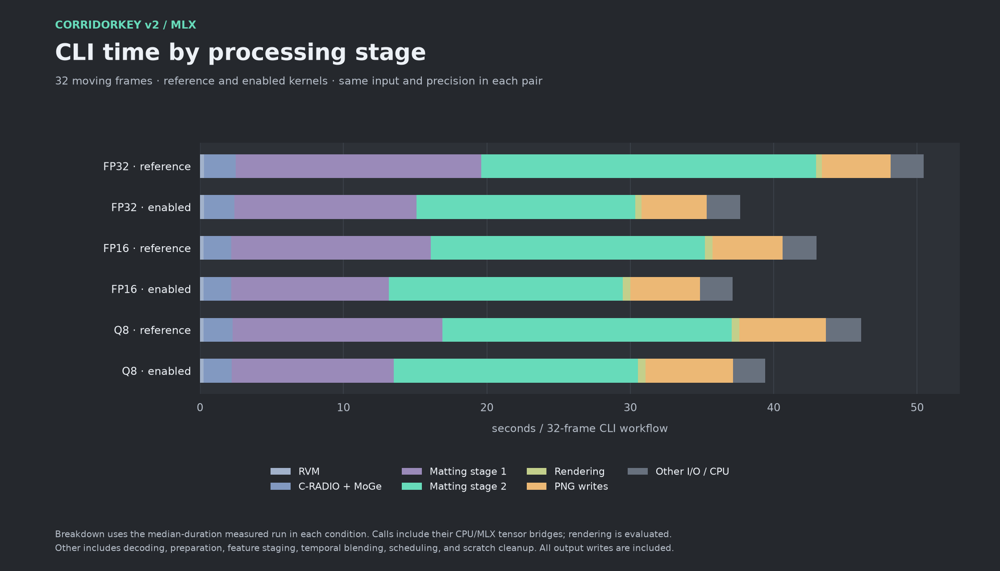
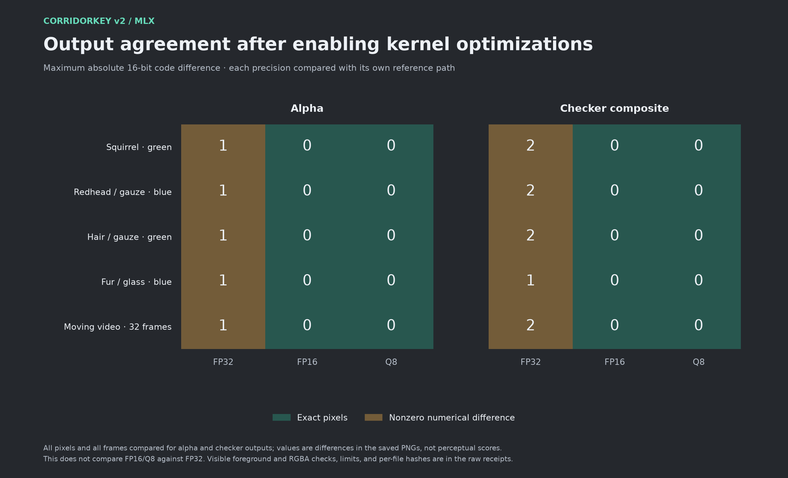
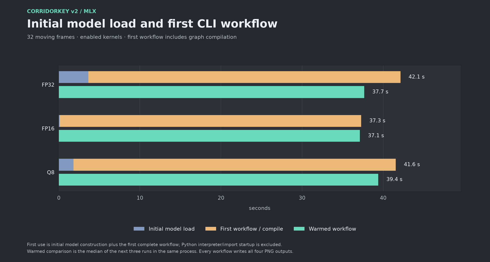

<div align="center">

# CorridorKey v2 · MLX

### Native-resolution matting on Apple Silicon

**Five neural networks on MLX. FP32, FP16, and Q8. A Python API and a practical CLI.**

[](LICENSE)
[](https://huggingface.co/cdelta/CorridorKey-v2-MLX)
[](#quick-start)

[Quick start](#quick-start) · [CLI guide](docs/CLI.md) · [Python API](docs/API.md) · [Measurements](docs/BENCHMARKS.md) · [Model card](https://huggingface.co/cdelta/CorridorKey-v2-MLX)

</div>

Run **CorridorKey 2.0** green-screen and blue-screen matting locally on a Mac.
This independent MLX implementation executes the recurrent encoder, both visual
foundation encoders, both matting stages, and output rendering on Apple Silicon.
Export a matte, clean foreground, untouched foreground, checker composite, or
straight-alpha cutout at the input's native resolution.

**CorridorKey 2.0 was designed and trained by Zachary Harris in collaboration
with Niko Pueringer and Corridor Digital.** Start with their
[original project](https://github.com/nikopueringer/CorridorKey2.0),
[official model](https://huggingface.co/nikopueringer/CorridorKey2.0), and
[official plugins](https://corridorkey.com). This community port and its
Apple Silicon optimization work are maintained by Peter Teravskis; no official
affiliation or endorsement is implied.



Actual FP32 outputs from this CLI. The squirrel demonstrates fine fur and a
blurred paw; the redhead demonstrates flyaway hair and translucent gauze.
The right halves show the removed background over a checkerboard. These are
synthetic demonstration plates, without ground-truth mattes.

| Example | Original input | Transparent 16-bit PNG |
| :--- | :--- | :--- |
| Squirrel · green screen | [Input](assets/examples/squirrel-input.png) | [RGBA cutout](assets/examples/squirrel-cutout.png) |
| Redhead · blue screen | [Input](assets/examples/redhead-input.png) | [RGBA cutout](assets/examples/redhead-cutout.png) |

## What is included

| Component | Purpose |
| :--- | :--- |
| **MLX core** | Execute shape-specialized JSON graphs and safetensors with native MLX operators and Metal kernels |
| **Command line** | Read a still, ordered image sequence, or video; preserve temporal state; export PNGs or video |
| **Python API** | Load the engine once and integrate it into another local workflow |
| **Evidence** | Timing samples, physical-memory measurements, quality comparisons, and conversion provenance |
| **Companion model repository** | FP32, FP16, and Q8 profiles, model licenses, notices, and SHA-256 manifests |

The source here is **Apache 2.0**. The model files are distributed separately
under the **Corridor Key Licence 2.0** and the foundation models' own licenses.
The code license does not change the terms covering those assets. See
[attribution and the license boundary](NOTICE).

## Quick start

Use an **Apple Silicon Mac**, **Python 3.12**, and enough available unified
memory for the selected profile. Validation used an **M4 Pro with 48 GiB**;
the measured physical footprints below are not minimum-RAM guarantees.
Install FFmpeg if you want video export. PNG export does not require FFmpeg.

```bash
git clone https://github.com/peterteravskis/corridorkey-v2-mlx.git
cd corridorkey-v2-mlx
python3.12 -m venv .venv
source .venv/bin/activate
python -m pip install '.[download]'

# Read the model license, then download all three precision variants.
# Put this directory on external storage if that suits your workflow.
hf download cdelta/CorridorKey-v2-MLX --local-dir /path/to/CorridorKey-v2-MLX
```

Check a still or clip before loading model weights:

```bash
corridorkey-mlx --check --image-sequence \
  --model-root /path/to/CorridorKey-v2-MLX \
  --input /path/to/plate.png
```

Export a 1536 × 1024 still:

```bash
corridorkey-mlx --compile --image-sequence \
  --model-root /path/to/CorridorKey-v2-MLX \
  --input /path/to/plate.png --output-dir outputs/plate \
  --outputs alpha fg raw_fg checker cutout
```

Export a 1536 × 1024 video with four-frame temporal windows:

```bash
corridorkey-mlx --compile \
  --model-root /path/to/CorridorKey-v2-MLX \
  --input /path/to/shot.mp4 --output-dir outputs/shot \
  --hann-chunk 4 --hann-stride 2
```

The default profiles use **height 1024, width 1536**. All three precisions also
include **height 768, width 1280** profiles for native 1280 × 720 footage; select
`--height 768 --width 1280`. Other dimensions need matching padded profiles. This CLI
does not silently resize your footage. Two- or three-frame clips need matching
temporal profiles; use `--hann-chunk 1 --hann-stride 1` to process them without
temporal windows. See [profile layout and limitations](docs/MODELS.md).

For blue-screen cleanup, add `--screen blue`. The default is green.

## Choose a precision

```bash
corridorkey-mlx --precision q8 --compile --image-sequence \
  --model-root /path/to/CorridorKey-v2-MLX \
  --input /path/to/plate.png --output-dir outputs/plate-q8
```

| Selection | Weights / compute | Practical tradeoff |
| :--- | :--- | :--- |
| `--precision fp32` | FP32 default | Numerical reference; largest memory footprint |
| `--precision fp16` | Mixed FP16 with FP32 sensitive operations | Lower memory; small numerical changes |
| `--precision q8` | Group-64 affine Q8 linear weights, FP16 residual weights/activations | Lowest measured memory; larger localized alpha changes |

Q8 packs **445 linear matrices**, covering **74.47% of floating-point parameters**,
and executes them with native MLX quantized matrix multiplication. FP16 and Q8
reduce memory use but change numerical results. The fresh CLI measurements
below compare time and memory; the [precision study](docs/PRECISION.md)
documents measured differences from FP32, including localized alpha changes.

## Outputs you can use

| Output | Contents |
| :--- | :--- |
| `alpha` | Matte, repeated into RGB for preview/export compatibility |
| `fg` | Foreground with the selected green/blue despill |
| `raw_fg` | Untouched decoded foreground prediction |
| `checker` | Corrected foreground composited over a checkerboard in linear light |
| `cutout` | Straight RGB plus alpha; 16-bit RGBA PNG or ProRes 4444 MOV |

PNG sequences are lossless 16-bit exports. H.264 files are review previews.
The CLI handles display-referred sRGB inputs; it does not expose the upstream
HDR/EXR workflow. Audio is not copied. The [CLI guide](docs/CLI.md) explains
hints, scratch storage, frame ordering, and color handling.

## Measured CLI performance

Fresh measurements of this packaged CLI on an **Apple M4 Pro with 48 GiB**, using
the distributed FP32, FP16, and Q8 profiles. Each condition runs one complete
warm-up followed by three measured workflows. Timings include input decoding,
neural inference, rendering, four completed 16-bit PNG outputs per frame, and
scratch cleanup. Initial model loading and compilation are reported separately.



The table below measures **32 moving frames at native 1280 × 720**, padded to
1280 × 768. Reference mode disables the custom graph rewrites and kernels;
enabled mode uses the release defaults. Both use identical weights, precision,
Hann windows/stride 4/2, and stage-two batch one.

| Precision | Reference | Enabled | Less time | Enabled physical memory |
| :--- | ---: | ---: | ---: | ---: |
| FP32 | 50.465 s | 37.657 s | **25.4%** | 7.05 GiB |
| FP16 | 42.975 s | 37.123 s | **13.6%** | 4.11 GiB |
| Q8 | 46.088 s | 39.397 s | **14.5%** | 3.28 GiB |



**The speed optimizations ship enabled.** FP32 uses specialized reconstruction,
reflection padding/layout, dense projection pairing, and paired 7×7 channel
convolution. FP16/Q8 use the accepted half-precision paired-convolution path.
Half-precision projection pairing remains disabled.



All four stills and all 32 moving frames were compared with optimizations
enabled and disabled at each precision. Every comparison passed the recorded
numerical limits. FP16 and Q8 outputs match their own reference paths exactly.
FP32 differs by at most **1/65535 in alpha** and **2/65535 in the checker output**.
These checks do not establish FP16/Q8 equality with FP32 or accuracy against
ground-truth mattes.





[Methodology and raw samples](docs/BENCHMARKS.md) ·
[Kernel implementation and isolated measurements](docs/OPTIMIZATIONS.md) ·
[Release validation](docs/VALIDATION.md).

The retained [MPS comparison](docs/HISTORICAL_BENCHMARKS.md) and isolated
operator studies use earlier measurement setups. Their ratios are not combined
with these CLI results. These measurements describe the recorded Mac and
fixtures, not a minimum-RAM requirement or a guarantee for other footage.

## Architecture

```text
RGB frames ──► native-resolution padding and input encoding
                    │
           RVM + C-RADIO + MoGe                  MLX
                    │
        stage 1 · overlapping temporal windows   MLX
                    │
          stage 2 · full-resolution refinement   MLX
                    │
          decode · despill · composite           MLX
                    │
             PNG / video export                 CPU / FFmpeg
```

PyTorch supplies CPU tensor preparation and resizing; it performs no neural
inference in this package. The default core keeps FP32 weights and compute, with
the model interface's BF16 input rounding and FP16 intermediate storage. Select
FP16 or Q8 explicitly to trade numerical agreement for memory. Unsupported
graph operations fail explicitly.

## Development

```bash
python -m unittest discover -s tests -v
python -m corridorkey_mlx --help
```

The [source provenance](SOURCE_PROVENANCE.json) records the packaged MLX modules.
The [model repository](https://huggingface.co/cdelta/CorridorKey-v2-MLX)
records the parent checkpoint and model-file hashes.
