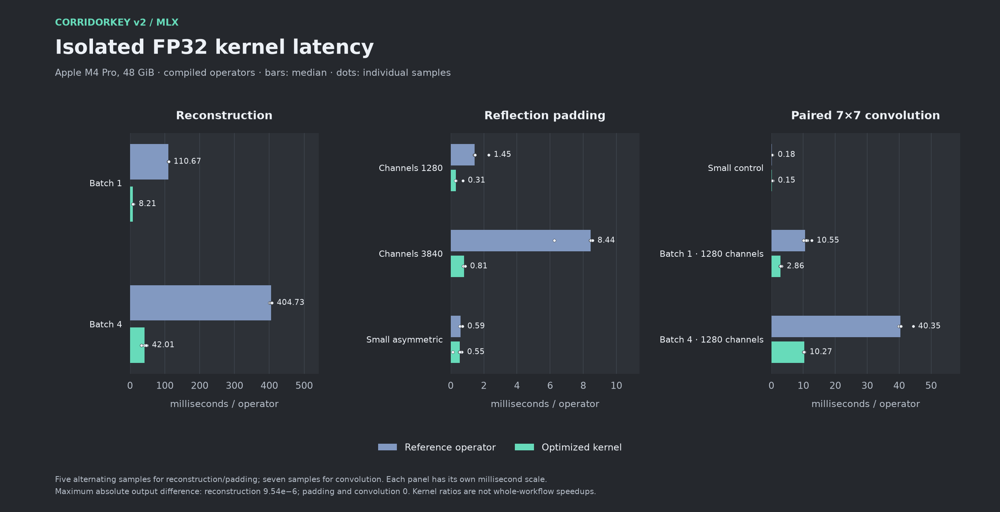
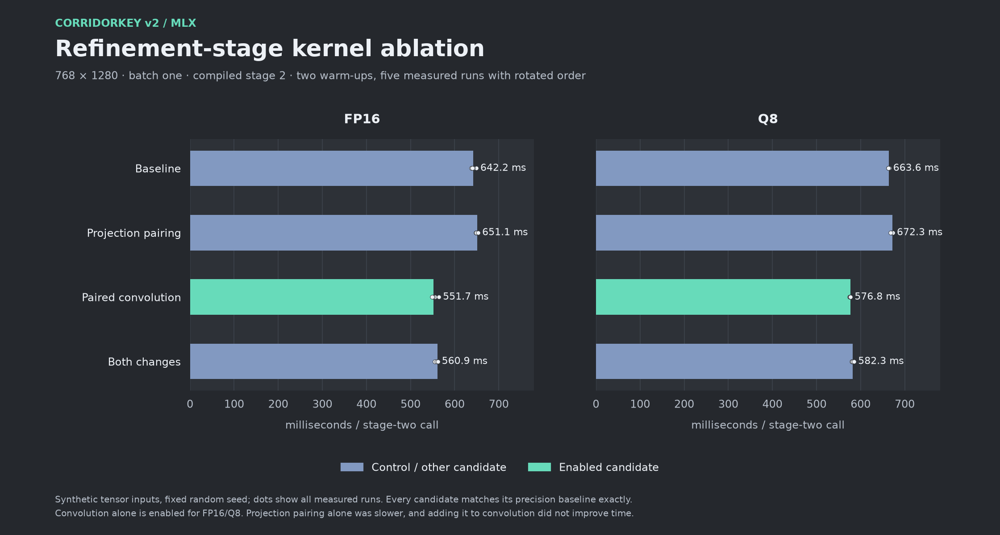

# Speed optimizations included in this release

[Home](../README.md) · [Precision choices](PRECISION.md) · [Raw results](../benchmarks/)

The model loader enables these automatically through `MLXGraph`:

| Path | Enabled work |
| :--- | :--- |
| FP32 | Reconstruction kernel; reflection padding and layout handling; dense projection specialization/pairing; paired 7×7 channel convolution |
| FP16 / Q8 | Paired 7×7 channel convolution that preserves half-precision rounding |

The default option set is `reconstruction`, `padding`, `layout`, `dense`,
`paired_dense`, `channel_conv7`, `half_channel_conv7`. Precision guards select
the applicable kernels. The `half_paired_dense` experiment is not enabled.
Experimental half reconstruction/padding substitutions remain disabled.

These optimizations retain the selected precision, resolution, and temporal
context. They do not substitute a smaller network. Batch one remains the CLI
default because the renewed batch-two screen did not improve throughput.

## Current CLI kernel comparison

`--kernel-mode reference` disables all custom graph optimizations. The default
`--kernel-mode enabled` uses the accepted kernels above. On the same 32-frame
moving clip, including four PNG writes per frame, the fresh CLI results are:

| Precision | Reference | Enabled | Less time | Enabled physical memory |
| :--- | ---: | ---: | ---: | ---: |
| FP32 | 50.465 s | 37.657 s | **25.4%** | 7.05 GiB |
| FP16 | 42.975 s | 37.123 s | **13.6%** | 4.11 GiB |
| Q8 | 46.088 s | 39.397 s | **14.5%** | 3.28 GiB |

All four stills and the moving clip pass the output-agreement limits at every
precision. FP32 has small rounding differences against the fully disabled
reference. See [methodology, limits, and receipts](BENCHMARKS.md).

The isolated measurements below are retained development evidence. They locate
the operator improvements; the fresh CLI comparison measures the shipped
workflow. The [older incremental convolution comparison](HISTORICAL_OPTIMIZATIONS.md)
used a different baseline and excluded PNG writes.

## Isolated kernel measurements

These measurements compare compiled operators on fixed inputs. Bars show the
median, with every recorded timing sample shown as a dot. Reconstruction and
padding have five alternating samples per implementation; convolution has
seven. Each panel uses its own millisecond scale.

| Kernel / shape | Reference median | Optimized median | Ratio |
| :--- | ---: | ---: | ---: |
| Reconstruction · batch 1 | 110.666 ms | 8.213 ms | 13.47× |
| Reconstruction · batch 4 | 404.733 ms | 42.011 ms | 9.63× |
| Reflection padding · 1280 channels | 1.454 ms | 0.307 ms | 4.73× |
| Reflection padding · 3840 channels | 8.435 ms | 0.812 ms | 10.38× |
| Paired 7×7 convolution · batch 1, 1280 channels | 10.548 ms | 2.859 ms | 3.69× |
| Paired 7×7 convolution · batch 4, 1280 channels | 40.348 ms | 10.268 ms | 3.93× |

The plot also includes the small controls, where the gains are much smaller.
Maximum absolute output difference is **9.54e−6 for reconstruction**, and
**zero for reflection padding and paired convolution**. These are isolated
operator ratios; the current CLI workflow is measured separately above.

Data: [reconstruction and padding](../benchmarks/isolated-kernels.json),
[paired convolution](../benchmarks/channel-conv.json).

## Controlled FP16/Q8 kernel selection

The compiled 768×1280 stage-two graph was measured with batch one, fixed-seed
synthetic inputs, two warm-ups, and five measured calls per candidate. Candidate
order rotated between runs. Convolution alone reduced FP16 stage time from
**642.2 ms to 551.7 ms**, and Q8 from **663.6 ms to 576.8 ms**. Each candidate's
raw outputs matched its precision baseline exactly.

Projection pairing alone was slower. Combining it with convolution was also
slower than convolution alone, which is why `half_paired_dense` stays disabled.
This graph test isolates the selected kernel's contribution; the moving-video
comparison above checks that it also improves the complete measured workflow.

Data: [all candidates and timing samples](../benchmarks/half-operator-screen.json).
