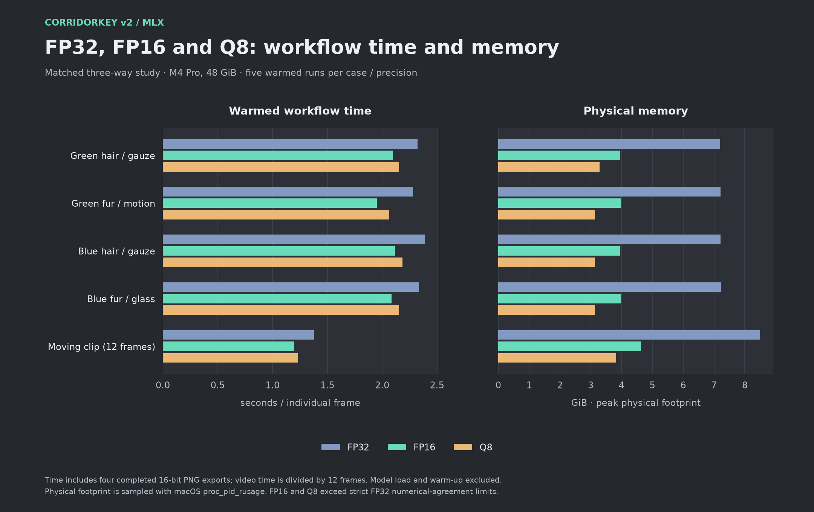

# FP32, FP16, and Q8

[Home](../README.md) · [Model profiles](MODELS.md) · [Optimizations](OPTIMIZATIONS.md)

All three variants run through the same MLX graph interpreter and CLI.
`--precision fp32` is the default; `fp16` and `q8` select the matching subfolders.
FP16 uses `fp16-mixed-v1` graph metadata; Q8 uses `q8-fp16-v1`. The CLI rejects
profiles whose declared precision does not match the selection.

Q8 quantizes 445 eligible constant linear matrices using group-64 affine
quantizers fitted to FP32 weights. Packed values are uint32, with FP16 scales
and offsets. Coverage is 74.47% of floating-point parameters. Unsupported
matrices, convolutions, normalization parameters, and biases remain FP16;
integer tensors remain integer. `mx.quantized_matmul` consumes packed weights
directly. This is mixed Q8/FP16 inference, not an all-integer network.

Both reduced-precision variants calculate sensitive reductions, normalization,
softmax, powers, and exponentiation in FP32 before returning to FP16. Color
decoding, despill, compositing, and export rendering are FP32.

Current CLI time and physical memory are in the [fresh CLI benchmark](BENCHMARKS.md).
The numerical precision comparisons below are retained development measurements.

## Matched measurements

M4 Pro, 48 GiB; one warm-up plus five measured runs per fresh process, with
order rotated by case. Times include decode through four completed 16-bit PNG
exports, excluding model load and warm-up. Video is a 12-frame 1280×720 excerpt,
padded to 1280×768, Hann 4/2, stage-two batch four. Stills are 1536×1024, batch
one. The current CLI uses batch one, so the historical video times describe
the measured development workflow rather than the new CLI.

| Workload | FP32 s | FP16 s | Q8 s | FP32 GiB | FP16 GiB | Q8 GiB |
| :--- | ---: | ---: | ---: | ---: | ---: | ---: |
| Green hair / gauze | 2.321 | 2.100 | 2.156 | 7.199 | 3.958 | 3.281 |
| Green fur / motion | 2.281 | 1.951 | 2.066 | 7.214 | 3.973 | 3.139 |
| Blue hair / gauze | 2.388 | 2.116 | 2.184 | 7.211 | 3.948 | 3.135 |
| Blue fur / glass | 2.337 | 2.085 | 2.155 | 7.225 | 3.973 | 3.143 |
| Moving video · 12 frames | 16.516 | 14.333 | 14.818 | 8.501 | 4.633 | 3.827 |



Q8 saves 17–21% of physical memory relative to FP16, while taking 2.6–5.9%
longer. FP16's largest rounded 8-bit checker-composite channel difference was
one level across these five cases; Q8's was 5–10 levels. Q8's largest local
alpha change was 0.068849 in the blue-glass example. Neither variant passes the
strict FP32 numerical agreement limits. These are agreement measurements,
not ground-truth matte scores or universal perceptual thresholds.

Raw results: [three-way study](../benchmarks/q8-results.json),
[earlier FP16 study](../benchmarks/fp16-results.json). The separate later
[convolution optimization](OPTIMIZATIONS.md) is already enabled.

## Reproduce conversions

The source includes the original conversion utilities:

```bash
python scripts/convert_mlx_precision.py \
  --source /path/to/FP32-profiles --destination /Volumes/YourSSD/FP16-profiles
python scripts/convert_mlx_q8.py \
  --source /path/to/FP32-profiles --destination /Volumes/YourSSD/Q8-profiles
```

They preserve the source profiles and record conversion hashes. Outputs must
be in a separate external-volume directory. The resulting model-derived assets
retain the model licenses; running Apache-licensed conversion code does not
relicense the weights.
